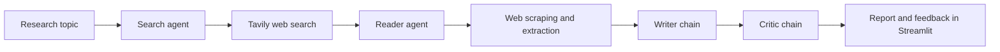

# Multi-Agent Research Assistant

A Streamlit app that turns a research topic into a sourced report. The app coordinates separate search, web-reading, writing, and review steps using LangChain and Groq.

## Features

- Search the web for recent information with Tavily.
- Extract readable content from a relevant source page.
- Generate a structured report with an introduction, key findings, conclusion, and sources.
- Get separate critic feedback on the generated report.
- Download the report as a Markdown file.

## Technologies

- **Python 3.12+** — application runtime.
- **Streamlit** — interactive web interface.
- **LangChain** — agent tools, prompts, and model pipelines.
- **Groq** — chat model provider (configured with `openai/gpt-oss-120b`).
- **Tavily** — web search.
- **Requests, Trafilatura, Readability, Beautiful Soup, and lxml** — fetch and extract web-page content.
- **python-dotenv** — load API keys from a local `.env` file.
- **uv** — dependency and virtual-environment management (lockfile included).

## Requirements

- Python 3.12 or newer.
- A [Groq API key](https://console.groq.com/keys).
- A [Tavily API key](https://app.tavily.com/).

## Installation and setup

1. Clone the repository and enter the project directory:

   ```bash
   git clone https://github.com/Menisy2004/MultiAgent-Research-Assistant.git
   cd MultiAgent-Research-Assistant
   ```

2. Install [uv](https://docs.astral.sh/uv/getting-started/installation/) if it is not already installed, then sync the locked dependencies:

   ```bash
   uv sync
   ```

3. Create a `.env` file in the project root and add your API keys:

   ```dotenv
   GROQ_API_KEY=your_groq_api_key
   TAVILY_API_KEY=your_tavily_api_key
   ```

   Keep this file private; do not commit API keys.

4. Start the app:

   ```bash
   uv run streamlit run app.py
   ```

   Streamlit will print a local URL (usually `http://localhost:8501`) to open in your browser.

### Install with pip instead

You can also create and activate a virtual environment, then install the dependencies from `requirements.txt`:

```bash
python -m venv .venv
```

Activate it on Windows:

```powershell
.\.venv\Scripts\Activate.ps1
```

On macOS or Linux:

```bash
source .venv/bin/activate
```

Then install and run:

```bash
python -m pip install -r requirements.txt
streamlit run app.py
```

## Architecture

The Streamlit interface in `app.py` collects a topic, runs each stage in order, displays intermediate results and the final report, and offers a Markdown download.



- **Search agent** (`src/agents/agents.py`) uses Tavily to find relevant pages.
- **Reader agent** (`src/agents/agents.py`) selects a URL from the search results and calls the scraping tool.
- **Web tools** (`src/tools/tools.py`) search with Tavily and retrieve/extract page text using Requests and HTML extraction libraries.
- **Writer and critic chains** (`src/agents/agents.py`) use LangChain prompts and the configured Groq chat model to draft and evaluate the report. The critic returns feedback; it does not automatically rewrite the report.
- **Pipeline module** (`src/pipelines/pipeline.py`) provides a console-oriented version of the same four-stage workflow. `main.py` runs that pipeline with a sample topic.

## Project layout

```text
.
├── app.py                  # Streamlit user interface
├── main.py                 # Console pipeline example
├── pyproject.toml          # Project metadata and dependencies
├── requirements.txt        # pip dependencies
├── uv.lock                 # Locked uv dependency versions
└── src/
    ├── agents/             # Search/reader agents and writer/critic chains
    ├── pipelines/          # Console research pipeline
    └── tools/              # Web search and page extraction tools
```

## Notes

- Research output depends on the quality and availability of third-party search results, web pages, and language-model responses. Verify important claims against the cited sources.
- The app makes external API and web requests; network access is required.

## Contributing

Contributions are welcome. For substantial changes, open an issue to discuss the proposal, then submit a pull request with a clear description and any relevant validation steps.

## License

This project is licensed under the Apache License 2.0. See [LICENSE](LICENSE) for details.
